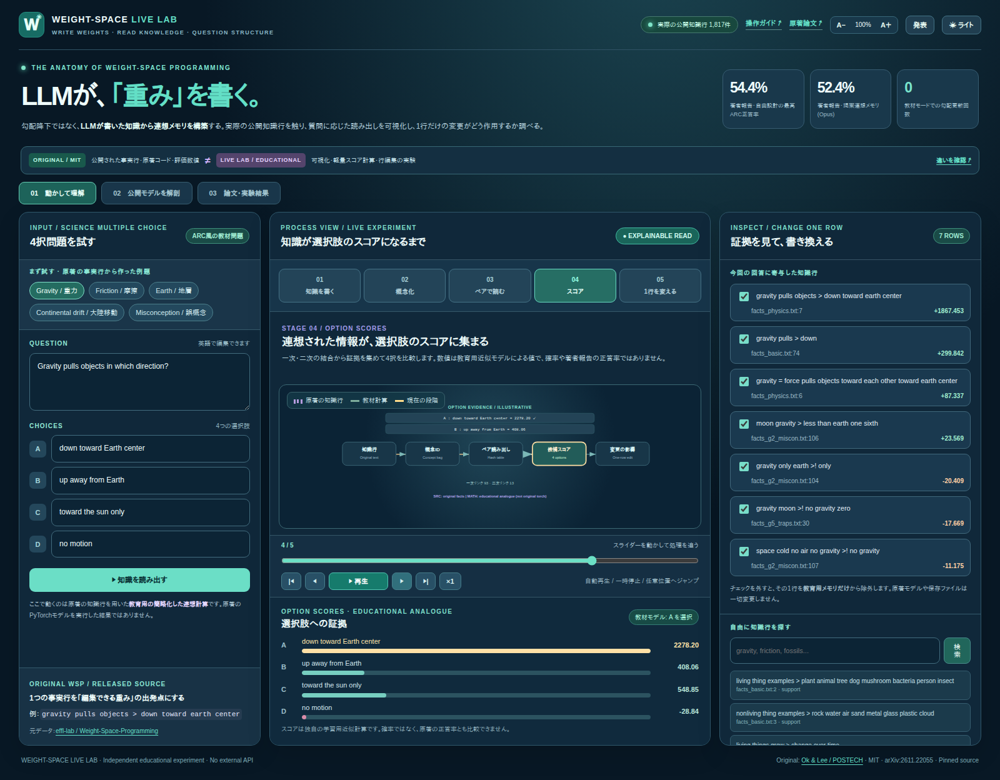
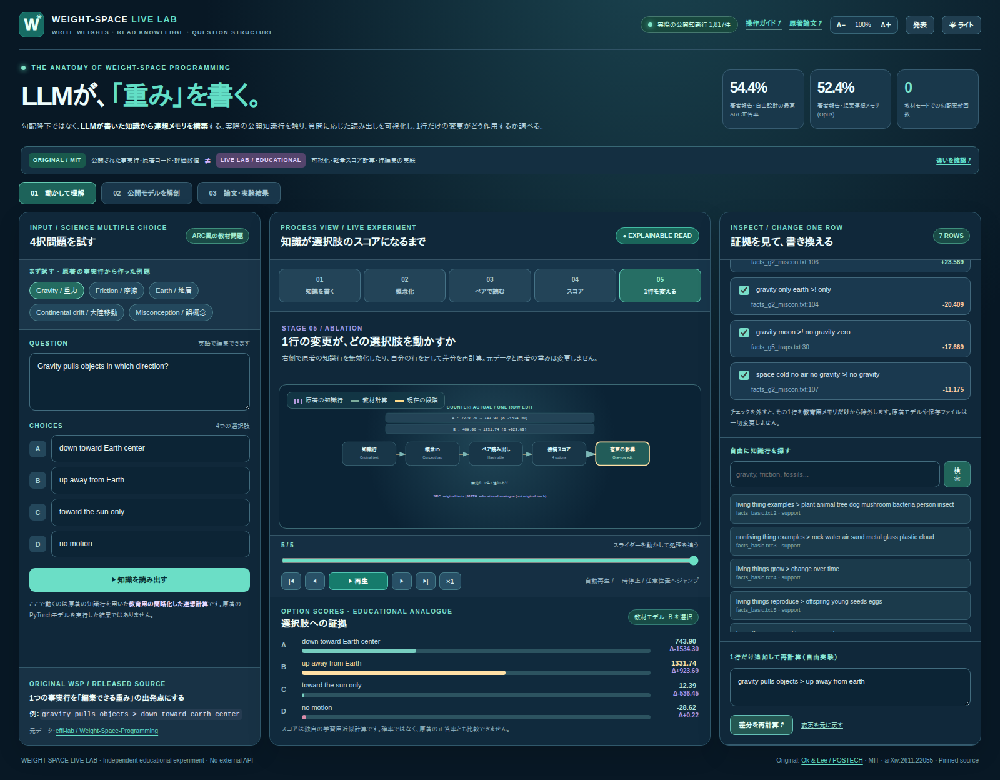
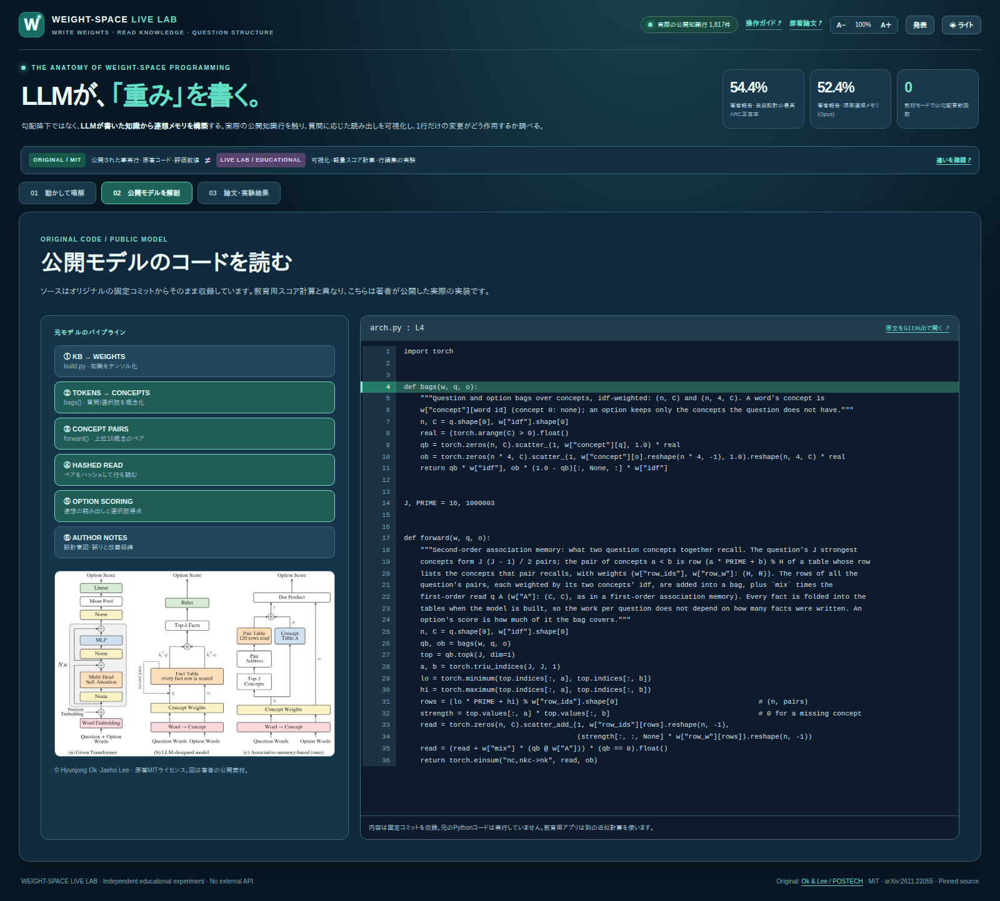
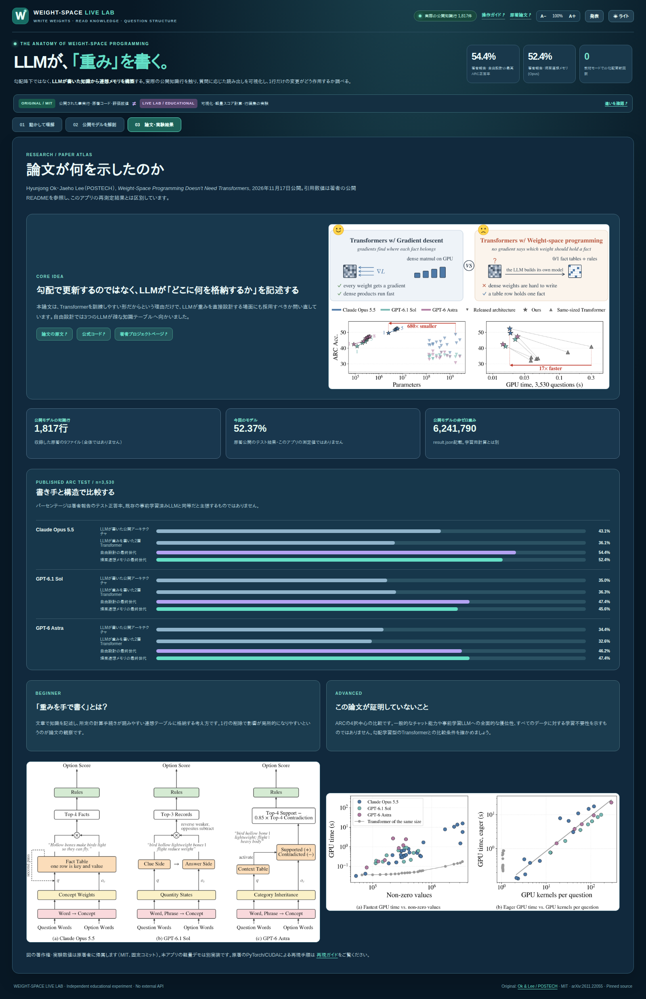
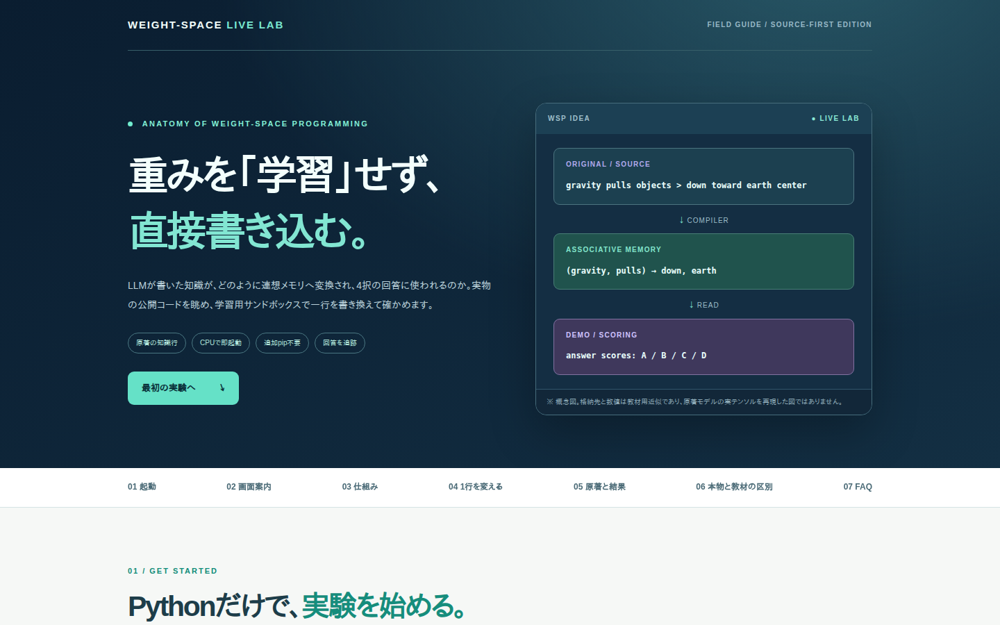
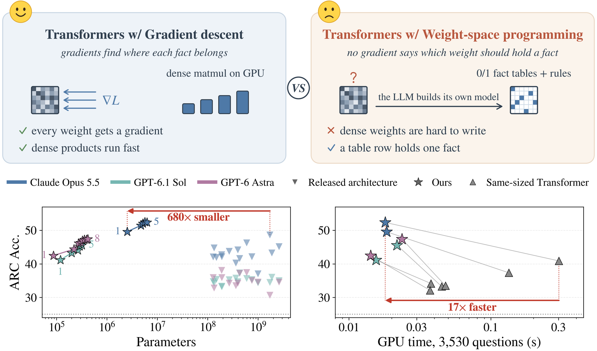
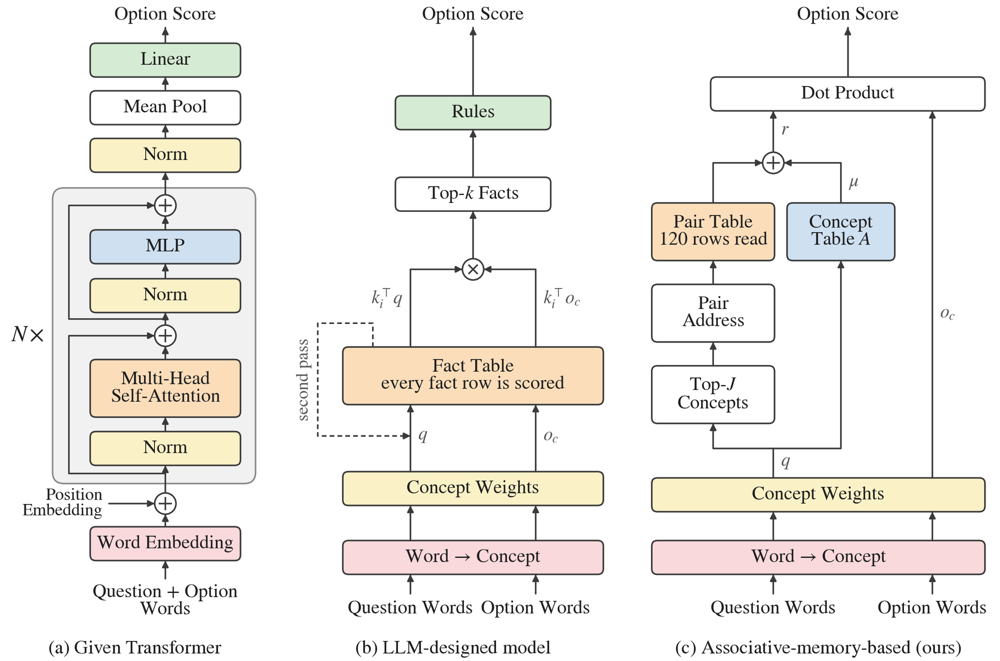

# Weight-Space Programming Live Lab

<strong>LLMが、モデルの「重み」を書く。</strong>

原著 <a href="https://github.com/effl-lab/Weight-Space-Programming">Weight-Space Programming Doesn't Need Transformers</a> を、<strong>公開知識を読む → 連想メモリを観察 → 4択で試す → 知識を1行編集する</strong>という体験で学ぶ独立した勉強会用Webアプリ。

▲ 実際の公開知識行を読み込んで撮影した画面。得点計算は独立した教材用近似モデルであり、原著のPyTorch推論ではありません。

  

<a href="#-macwindowsで一発起動"><strong>🚀 すぐに動かす</strong></a> · <a href="docs/MANUAL.html"><strong>📖 図解HTMLマニュアル</strong></a> · <a href="#-どんな研究か"><strong>📚 原著を理解する</strong></a> · <a href="docs/REPRODUCE_ORIGINAL.html"><strong>🔬 原著の再現環境</strong></a>

## 🔬 何ができる？

<table>
<tr>
<td width="50%" valign="top">
<strong>① 知識行から4択の得点へ</strong> 

段階スライダーで「知識行 → 概念ID → ペアアドレス → 選択肢スコア」を実験。スコアは教材の近似値です。
</td>
<td width="50%" valign="top">
<strong>② 知識を1行だけ無効化・追加</strong> 

1行だけ削ったときの得点差を可視化。実際の公開モデルファイルは一切変更しません。
</td>
</tr>
<tr>
<td width="50%" valign="top">
<strong>③ 本物のソースコードへ</strong> 

公開モデルの <code>arch.py</code> / <code>build.py</code> / <code>NOTES.md</code> を固定版から収録。元の行番号と公式GitHubへのリンクがあります。
</td>
<td width="50%" valign="top">
<strong>④ 論文の仕組み・数値・限界を理解</strong> 

著者の構造図、ARC正答率、PyBotとの違い、初級／上級向けの検討ポイントを整理。
</td>
</tr>
</table>

## 🚀 Mac／Windowsで一発起動

**Python 3.8以上だけ。通常の教材アプリは、GPU・仮想環境・pip追加インストール・外部LLM APIキーが不要です。**

1. **Code → Download ZIP** でダウンロードして展開（git cloneでも可）。
2. Macなら **start_mac.command**、Windowsなら **start_windows.bat** をダブルクリック。
3. ブラウザで **Gravity / 重力 → ▶ 知識を読み出す** を選ぶ。

ターミナルからはMacで <code>python3 launch.py</code>、Windowsで <code>py -3 launch.py</code>。ローカルの <code>127.0.0.1</code> だけで動きます。

> **重要：** この「依存なし」は教材アプリのことです。原著の実際のPyTorchモデル・実験管理には別のPython環境、Linuxのbubblewrapなどが必要です。[原著再現ガイド](docs/REPRODUCE_ORIGINAL.html)で分けて解説しています。

## 📖 図解HTMLマニュアル

CSS・実画面スクリーンショット・著者の図版を埋め込んだ単体HTMLです。オフラインでも読めます。

<a href="docs/MANUAL.html"><strong>図解ガイドを開く ↗</strong></a>

## 🧠 どんな研究か

Hyunjong Ok・Jaeho Lee（POSTECH）, *Weight-Space Programming Doesn't Need Transformers*, 2026年11月17日公開。論文は <a href="https://arxiv.org/abs/2611.22055">arXiv:2611.22055</a> で公開されています。

| 観点 | 原著で示された内容 |
| --- | --- |
| 何が新しい？ | LLMが明示的な知識とモデル重みを書き、勾配降下を使わず構築する |
| タスク | 主にARCの4択科学問題（テスト3,530問） |
| 自由設計したモデル | 疎な知識テーブルへ向かい、ARCの最高テスト正答率 **54.4%** |
| 著者提案の連想メモリ | Opus系で **52.4%**（論文中の丸め値） |
| 推論速度 | 比較条件下で同程度のパラメータ数のTransformerよりGPU上で最大17倍高速と報告 |
| 主張の範囲 | 事前学習済みLLMが一般に劣る、Transformerが不要になる、という証明ではありません |

<strong>原著者が公開した図を見る</strong>

© Hyunjong Ok・Jaeho Lee / MIT License。

## 🔍 どこまでが原著で、どこからが教材？

| 元の公開資料をそのまま収録 | このアプリの学習用近似処理 |
| --- | --- |
| 9ファイルの原著知識行 | 簡略化した語彙・IDFと概念ID |
| <code>arch.py</code>・<code>build.py</code>・<code>NOTES.md</code> | 一次・二次連想の簡略読み出し、ステップ表示 |
| 公開 <code>result.json</code> と原著の性能表 | 4択の教材スコアと知識1行を無効化した差分 |
| 著者の図版 | 段階アニメーション、原文検索とコード表示 |

**教育用のスコアは元モデルの推論値でも、ARCの性能測定値でもありません。** 原著の全テンソルや52.4%のARC正答率を再現したとは主張しません。

## 📚 出典・権利と検証

**原著：** https://github.com/effl-lab/Weight-Space-Programming  
**論文：** https://arxiv.org/abs/2611.22055  
**固定したソース：** https://github.com/effl-lab/Weight-Space-Programming/tree/c3324efa7e8aeec9ff7b7303094799b67a20793b  
**MITライセンス：** [原著ライセンス](sources/reference/LICENSE) · [出典マニフェスト](sources/SOURCE_MANIFEST.json)

テストは <code>python -m unittest discover -s tests -v</code> と <code>python launch.py --self-check</code>。Mac／Windows／LinuxのGitHub Actionsで基本動作を確認します。ブラウザ表示と実スクリーンショットの自動生成も実装しています。

このアプリは原著者の公式配布物ではなく、**原著の理解を支援する独立した教育用アプリ**です。
